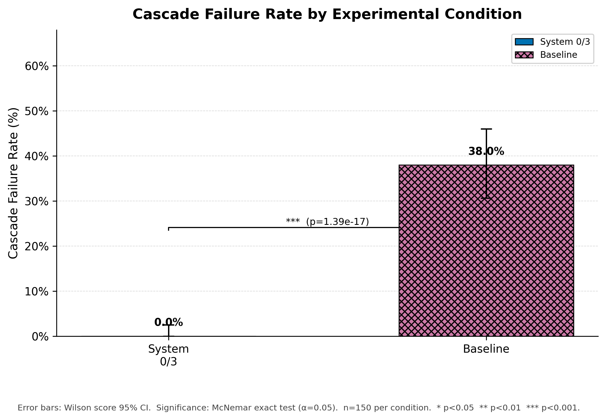
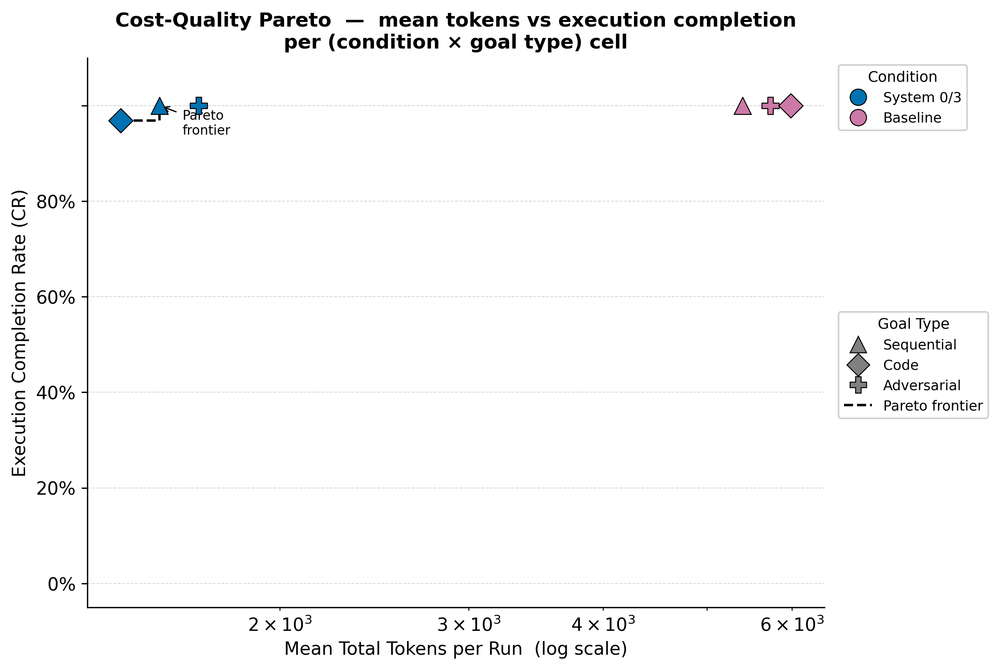
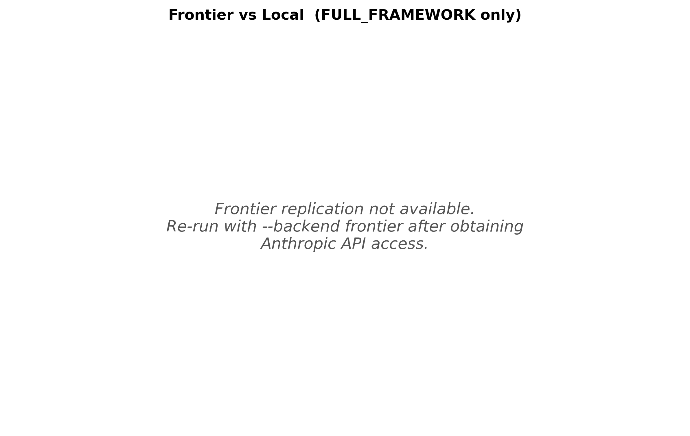

## Experimental Results

Generated: 2026-05-24T12:59:49Z  
Total runs: 300  
Repo SHA: `e2d1b8c7e958`

---

### Sample Sizes

| Condition | Sequential | Code | Adversarial | **Total** |
| --- | --- | --- | --- | --- |
| Baseline | 27 | 32 | 91 | **150** |
| System 0/3 | 27 | 32 | 91 | **150** |

---

### Primary Outcomes (pre-registered; thesis §6.4)

Significance threshold α = 0.05

| Test | Statistic | p | Sig? | Effect Size | 95% CI |
| --- | --- | --- | --- | --- | --- |
| System 0/3 vs Baseline — CFR (McNemar) | b=0, c=57 | < 0.001 | **Yes** | h=-1.328 | [-0.460, -0.300] |
| System 0/3 vs Baseline — Completion (McNemar) | b=0, c=1 | 1.00 | No | h=-0.163 | [-0.020, 0.000] |
| System 0/3 vs Baseline — Tokens (Wilcoxon) | median Δ=-3735.0 | < 0.001 | **Yes** | δ=-0.930 | [-4549.725, -3701.480] |

---

### CFR by Condition

| Condition | CFR | 95% CI | n |
| --- | --- | --- | --- |
| Baseline | 0.380 | [0.306, 0.460] | 150 |
| System 0/3 | 0.000 | [0.000, 0.025] | 150 |

*[PDF version](figures/cascade_bar.pdf)*

---

### Capability & Performance

> **Caveat (DEV-020 — `--judge-all` override).** 299/300 runs in this log were graded under the `--judge-all` override; Accuracy/JPI below are **exploratory only**.

> **Note.** 1/300 runs were graded deterministically (no semantic judge calls).

| Condition | n | Accuracy [95% CI] | JPI [95% CI] | Execution Completion Rate (CR) |
| --- | --- | --- | --- | --- |
| System 0/3 | 150 | 0.380 [0.300, 0.460] | 0.395 [0.349, 0.439] | 0.993 |
| Baseline | 150 | 0.080 [0.040, 0.127] | -0.131 [-0.167, -0.095] | 1.000 |

---

### Cost-Quality

| Condition | Mean Tokens | Std Tokens | Execution Completion Rate (CR) | n |
| --- | --- | --- | --- | --- |
| Baseline | 5,724 | 2,754 | 1.000 | 150 |
| System 0/3 | 1,600 | 1,054 | 0.993 | 150 |

> **Note on Execution Completion vs. Task Accuracy.** Execution Completion merely tracks whether the system finalized its runtime loop without throwing an unhandled software crash exception. System 0/3 (99.3%) exhibits a lower completion rate than the Baseline (100.0%) because its System-3 meta-controller actively executes intentional, defensive early-stopping halts when adversarial data corruption is deemed unrecoverable. The baseline blindly completes a higher fraction of runs (up to 100.0%) by emitting low-quality, corrupted single-step fragments. True capability is measured by the **Accuracy** and **JPI** metrics below.

*[PDF version](figures/cost_quality_pareto.pdf)*

---

### Frontier Replication

| Backend | n | CFR | Execution Completion Rate (CR) |
| --- | --- | --- | --- |
| Local (phi3 + llama3.1:8b) | 150 | 0.000 | 0.993 |
| Frontier (Claude Sonnet) | — | — | — |

> Frontier replication runs not yet available.  Re-run with `--backend frontier` after obtaining Anthropic API access.

*[PDF version](figures/frontier_vs_local.pdf)*

---

### Robustness Checks

#### Temperature Sweep

| Temperature | CFR | n |
| --- | --- | --- |
| t=0.0 | 0.000 | 22 |
